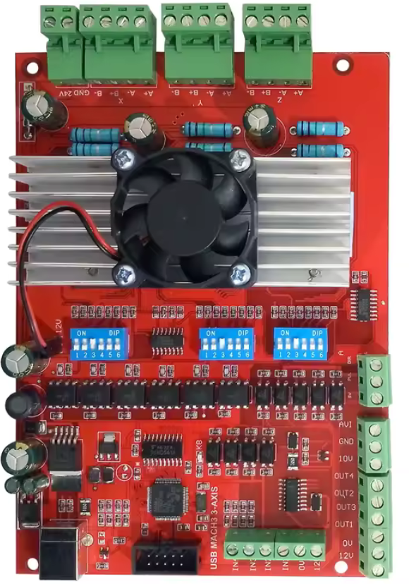

# GRBL2MACH

Drive Mach3-era Chinese USB motion controllers (the "RNR Eco Motion 2.0" family, including the red
4-axis Bitsensor boards) from **gSender** or any other GRBL-compatible sender.

GRBL2MACH is a bridge that runs on the PC. To the sender it looks like a GRBL board; on the machine
side it speaks the controller's USB HID protocol. Its core is the
[grblHAL Simulator](https://github.com/grblHAL/Simulator), which compiles the real grblHAL core
(G-code parser, look-ahead planner, homing, probing, `$` settings) as a desktop program.
GRBL2MACH replaces the simulated hardware with the USB controller.

**Edit your Mach3 profile online, without Mach3:
[Mach3 profile editor](https://manuprendlair.github.io/GRBL2MACH/tools/mach3_editor.html)**
(runs in your browser; the file never leaves your computer).

> **Status: work in progress, tested on the author's setup only.** One machine with one board (the
> red "USB MACH3 3-AXIS" pictured below), driven by gSender 1.6.4 on Windows 10: connection, settings
> (written back to the Mach3 profile), homing, jogs, probing, a full pocket program with feed hold,
> resume and stop, and the failures described in
> [Failures during a job](#failures-during-a-job-what-to-expect). The spindle of this machine is not
> driven by the board yet. Other boards, machines, PCs and senders are untested, so feedback from the
> community is very welcome: please open an
> [issue](https://github.com/manuprendlair/GRBL2MACH/issues) with what worked and what did not. Use
> a hardwired e-stop and try it first without a tool. See [Safety](#safety).

## Install on Windows (nothing to compile)

**[Download the installer: GRBL2MACH-0.1.1-setup.exe](https://github.com/manuprendlair/GRBL2MACH/raw/master/release/GRBL2MACH-0.1.1-setup.exe)**
(the [release](release) folder holds it).

You need: Windows 10 or 11 (64-bit), a board with the USB IDs given under
[Target hardware](#target-hardware), your Mach3 profile (the `.xml` file in your Mach3 folder, for
example `C:\Mach3\Mach3Mill.xml`) and [gSender](https://sienci.com/gsender/) or another
GRBL-compatible sender.

1. Run the installer. The installer is not signed: if Windows shows a SmartScreen warning, click
   *More info*, then *Run anyway*. No administrator rights are needed.
2. Choose your Mach3 profile when asked. A copy is made; your Mach3 profile is not modified. An update
   keeps the copy already installed, with the settings you changed since.
3. Close Mach3 (it holds the controller), plug in the board, and double-click **GRBL2MACH** on the
   desktop. A window opens and must stay open: closing it stops the bridge.
4. In gSender: *Config* > *Connection*: Ethernet IP `127.0.0.1`; then in the connection panel choose
   *Ethernet* and *Connect*. See [Using gSender](#using-gsender).

Wire a hardwired e-stop and start without a tool: see [Safety](#safety) and
[Failures during a job](#failures-during-a-job-what-to-expect). To remove the program: *Settings* >
*Apps* in Windows; your profile and settings stay in its folder.

## Goals

- Use gSender (or Candle, UGS, ...) with a controller that was sold for Mach3 only.
- **Never write to the controller's firmware**: Mach3 keeps working with the same board at any time.
- Probing (G38.x, workpiece and tool length) is a hard requirement.
- Import the machine configuration from an existing Mach3 XML profile.

## Target hardware

| Item | Value |
|---|---|
| USB IDs | VID `0xA720`, PID `0xF803` ("RobotAndRobot.com", "RNR ECO MOTION 2.0") |
| Reference board | red board marked "USB MACH3 3-AXIS": TB6560 drivers for X, Y, Z on board, step/direction terminal for A, inputs IN1-IN4, outputs OUT1-OUT4 |
| Interface | USB HID, report IDs 2 (8 bytes) and 3 (26 bytes) out, 1 (48 bytes) in; status about every 50 ms |
| Axes | X, Y, Z, A, up to 100 kHz step rate |
| Principle | the PC plans, the controller executes: every 5 ms the PC sends a "slice" of signed steps per axis; outputs OUT1..OUT4 ride in the slices during motion and in separate frames at rest; spindle speed is a PWM frame |

<p align="center"><br>
<em>The board GRBL2MACH was developed on ("USB MACH3 3-AXIS", RNR Eco Motion 2.0 controller).</em></p>

These boards are sold under many names with no common reference: what identifies them is the USB
ID above (Device Manager > the device > Details > Hardware IDs: `VID_A720&PID_F803`) and the
Mach3 plugin they come with. GRBL2MACH was developed against this plugin, which is **not**
distributed here (proprietary). Compare yours with its SHA-256 (PowerShell:
`Get-FileHash RnRMotion.dll`):

| Mach3 plugin | |
|---|---|
| File | `RnRMotion.dll` (Mach3 `PlugIns` folder), 275 968 bytes |
| Version | 3.5.0.0, "BS Control Mach3 Plugins" (product "BSMotion", original name `BSMotionMini`); configuration dialog "Bitsensor Motion Controller Configuration", version 3.50 |
| SHA-256 | `7551e4221db28706fb48955c15cfbca83a2eac298ed43e586859eb1f07726f07` |

A different plugin with the same USB IDs probably speaks the same protocol; a USB capture of
Mach3 (start-up and Reset) shows it quickly.

**The protocol is documented in [docs/PROTOCOL.md](docs/PROTOCOL.md)**: frames, configuration
encoding, status report, states and sequences (arming, runs, jog, stop, e-stop, homing, probing,
outputs). It comes from USB captures of Mach3 driving the reference machine (about 40 captures,
plus 15 variants of the input settings), cross-checked with the notes published by
[BreakoutCNC](https://github.com/rolanddd-hu/BreakoutCNC) and static analysis of the plugin. The
bridge drives the board the way Mach3 does.

## How it works

```
 gSender / Candle / UGS --(TCP or virtual COM port)--> grblHAL core (running on the PC)
                                                          |  parser, planner, homing, probing,
                                                          |  status reports, $ settings
                                                          v
                                               slicer: counts step pulses per 5 ms slice
                                                          |
                                                          v
                                               slice sink: file, RNR USB controller or fake controller
```

- **Slicer** (`src/slicer.c`): step pulses are counted where the simulated driver emits them
  (`src/driver.c`) and stored in the 5 ms slice matching their simulated time. While the stepper
  runs, every slice is emitted (even empty ones) so the controller keeps the simulator's timeline.
- **Slice sink** (`src/slice_sink.h`): one interface for every consumer of slices. When a sink is
  full, the simulator waits (back-pressure), so simulated time never runs ahead of the machine.
  Implementations: **file** (`src/sink_file.c`, CSV) and **RNR controller** (`src/rnr/sink_rnr.c`), which
  talks either to the real board over USB HID or to a **fake controller** used by the tests.
- **RNR sink**: a dedicated I/O thread reads status reports continuously and keeps the board about
  160 ms ahead (Mach3 keeps about 0.5 s ahead). A run starts once 100 ms of motion is queued (40 ms
  for a jog of one axis, so that it starts at once). The
  board acknowledges a slice as soon as it has buffered it, so pacing on acknowledgements alone
  would let the machine run far behind; pacing on the PC clock alone does not work either: the
  board runs a slice in about 5.02 ms, and its buffer (so the lag of a jog stop) grew by 4-7 ms
  per second of motion. The pacing is closed-loop: the bridge estimates how many slices of the run
  the board has run (in time) and puts that estimate back on the slice whose cumulative steps
  match the step counters of each status report, whenever that match is unambiguous.
  - Program runs use the same frames as Mach3: arming (pre-reset, clear e-stop, set positions,
    configure), "G-code" slices, then end of motion. After each run, the board's step counters are
    checked against the steps sent.
  - Jogs of one axis use the same frames as Mach3 (`0x0A`, jog slices). When a jog is stopped, the
    board is told to drop what it holds (`0x10`) and runs the deceleration slices at once; once it is
    at rest, grblHAL's position is taken from its step counters.
  - Every grblHAL reset (Ctrl-X, alarm) sends a cancel at once, like Mach3's Stop button: the
    board stops and drops its buffer, but stays armed.
  - Inputs: the board's configuration frame declares its e-stop, probe, home and limit inputs, in
    the encoding of Mach3's plugin (decoded from USB captures, `rnr_encode_pins()`). The e-stop
    input (IN1 by default, `--rnr-estop-in`) is declared, so the board stops on it by itself,
    without the PC; tested on the real board: with no e-stop declared it only reported the input and
    kept moving. The bridge also watches it in the raw inputs and sends the board's e-stop frame at
    once, like Mach3. grblHAL raises ALARM:10; the board is re-armed before the next move, once the
    input is released and grblHAL reset. Home, limit and probe inputs are passed to grblHAL
    (`Pn:` in the status report), polarity applied.
  - Homing (`$H`) and probing (`G38.2`, `G38.3`) are grblHAL's own cycles, configured with its
    usual settings (`$22` to `$27`, `$44` to `$46`...). The bridge only sends each phase to the
    board the way Mach3 does: a homing move towards the switch of one axis is armed on the board
    (frame `0x0D`), which stops by itself exactly on the switch; pull-offs are jogs (`0x0A`); a
    probing move is armed with `0x0C`, the board stops by itself on contact and latches the position,
    which replaces grblHAL's own (late by up to a status period). The slices grblHAL still sends
    after the stop are dropped. A homing cycle with several axes at once works too, but each switch
    is then seen through status reports (about 50 ms late, plus the bridge's lead): one axis per
    cycle is more precise, and required anyway when switches share an input. `G38.4`/`G38.5`
    (probing away) are handled by grblHAL alone, with the same latency. At the end of a pull-off,
    grblHAL checks that the switch has released: the bridge makes that check wait until the board
    has actually run the pull-off (it is up to about 0.2 s behind), else a switch with some
    hysteresis still reads engaged (ALARM:8, seen on the reference machine). Set `$27` (pull-off)
    above the switch hysteresis.
  - A 500 ms status watchdog or USB loss is reported as a motor fault (ALARM:17) and disarms the
    board, even at rest. The bridge then looks for the board again every second; once it is back
    (plugged in again, powered up again), the bridge configures it as at start, takes its step
    counters as the machine position, clears the motor fault and resets grblHAL, which comes back
    in alarm with the message `Controller reconnected: machine position lost, home the machine`.
    Home (`$H`), or unlock (`$X`) if you know the machine did not move. The TCP connection of the
    sender stays open throughout.
  - Spindle and coolant: grblHAL's spindle (M3/M4, S) and coolant (M7/M8) drive the board's PWM
    frame and outputs OUT1..OUT4 (`--rnr-out`). As grblHAL changes them between moves only, a run is
    closed before an output switches, and the switch goes out once the motion before it has run (not
    ahead of it). During a run, every slice carries the outputs, like Mach3. The PWM duty is
    `S / $30` in 1/1000, like Mach3 (S12000 with `$30=24000` = 500/1000).
- **Input from the sender**: bytes are read as soon as they arrive. Realtime commands (status,
  feed hold, resume, stop, reset) go straight to the core, as an interrupt would on a real controller,
  even when its input buffer is full; the other bytes wait for room, and a reset, a stop or the loss
  of the sender drops them.
- **Position resync**: the simulator runs a little ahead of the machine (queued slices). After a
  reset, grblHAL's position is set back to where the board actually stopped (its step counters plus
  the offset between grblHAL and the counted steps, sampled at rest), before any new command runs.
- **Interrupt lock** (`src/irq_lock.c`): the upstream simulator runs its simulated interrupt
  handlers on its own thread, concurrently with the core thread, while the core assumes (as on a
  microcontroller) that it is suspended during a handler. A recursive lock restores that: the core
  thread holds it and releases it only at its yield points (main loop pass, delays, clock polling
  while a handler waits); the simulator thread takes it around every handler. If the core thread
  ever keeps it 250 ms while a handler waits, the bridge says so, and during motion it stops the
  machine and raises ALARM:17: the exclusion is never given up.
  `--no-irq-lock` restores the upstream behaviour. See grblHAL/Simulator issue #28.

## Building

Only needed to change the program: see [Install on Windows](#install-on-windows-nothing-to-compile)
otherwise. `packaging\build_installer.ps1` builds the installer (needs [Inno Setup](https://jrsoftware.org/isinfo.php)).

### Windows (MinGW-w64)

The simulator targets GCC; MSVC is not supported (the grblHAL core uses GCC extensions and POSIX
headers). Any MinGW-w64 GCC works, for example [WinLibs](https://winlibs.com/) (UCRT, POSIX
threads) or [MSYS2](https://www.msys2.org/), plus [CMake](https://cmake.org/) 3.10 or later.

```
git clone --recurse-submodules <this repository> GRBL2MACH
cd GRBL2MACH
cmake -S . -B build -G Ninja -DCMAKE_BUILD_TYPE=Release -DCMAKE_C_COMPILER=gcc
cmake --build build
```

The simulator is built with 4 axes (X, Y, Z, A), the controller's; the upstream simulator builds 3.

(`-G "MinGW Makefiles"` works too.) A MinGW-only workaround for a `strset()` name clash between
the grblHAL core and MinGW's `<string.h>` is applied automatically, see `cmake/mingw_strset_fix.h`.

### Linux / macOS

```
cmake -S . -B build -DCMAKE_BUILD_TYPE=Release
cmake --build build
```

## Usage

GRBL2MACH adds these options to the simulator (all other options are described in
[README.simulator.md](README.simulator.md)):

```
grbl2mach -o <slice file>    write 5 ms step slices (CSV) to a file
grbl2mach -u                 drive the RNR Eco Motion USB controller (needs MACH3.xml, see below)
grbl2mach -f <log file>      drive a fake RNR controller (tests), logging every frame
grbl2mach -l <address>       address to listen on with -p (default 127.0.0.1)
grbl2mach --no-irq-lock      let simulated interrupts run concurrently with the core (upstream)
grbl2mach --mach3 <file>     the machine's Mach3 profile (default: MACH3.xml next to the program)
grbl2mach --rnr-lead <ms>    how far ahead of the board the bridge keeps it, 40 to 400 (default 150)

options overriding what the Mach3 profile describes (trials, tests):
grbl2mach --rnr-invert <hex> step/direction inversion sent to the controller (default 0)
grbl2mach --rnr-out spindle=1,ccw=0,flood=0,mist=0   controller outputs (default: spindle on OUT1)
grbl2mach --rnr-in xhome=3low,...,probe=2            controller inputs (as Mach3's Input Signals page)
grbl2mach --rnr-estop-in <n>[low]                    e-stop input (default 1: IN1 active high)
grbl2mach --rnr-pins <20 hex digits>                 input bytes copied from a Mach3 capture instead
```

`--rnr-lead` is the margin against a PC that falls behind. A larger value suits a slow or busy PC
(watch `lead min` and `underruns` in the console, see
[Failures during a job](#failures-during-a-job-what-to-expect)); a smaller one makes feed hold and
stop react sooner, and leaves less motion to run if the PC stops. Reset, e-stop and the stop of a
jog of one axis act at once whatever the value.

`--rnr-invert` takes the same values as Mach3's *Ports & Pins > Motor Outputs* page: bits 0-3 make
the step pulse active low on X, Y, Z, A ("Step Low Active"), bits 4-7 invert the direction of X, Y,
Z, A ("Dir LowActive"). Example: step low active on all four axes, A direction inverted: `0x8F`.
**Use the same values as your Mach3 profile**: a wrong step polarity can lose steps.

`--rnr-out` assigns OUT1..OUT4 (0 = none) to: `spindle` (on with M3 or M4), `ccw` (M4, when the
spindle has a separate counter-clockwise output; 0 = same as `spindle`), `flood` (M8) and `mist`
(M7), as in Mach3's *Ports & Pins > Output Signals* and *Spindle Setup* pages. Set `$30` (maximum
spindle speed) to the speed reached at 100 % PWM.

`-o`, `-u` and `-f` are mutually exclusive. With `-u` or `-f`, the simulation runs at 1.05 x real
time unless `-t` is given; slice back-pressure then locks it to the machine.

Example: listen on TCP port 23023 and write slices to `slices.csv`:

```
grbl2mach -n -p 23023 -o slices.csv
```

Each CSV line is `index,t_s,dx,dy,dz,da,out,pwm` (slice number, start time in seconds, signed steps
per axis, outputs bitmask: 1 spindle, 2 counter-clockwise, 4 flood, 8 mist; spindle PWM in 1/1000). The last line gives the totals.

> `-u` has been tested on the reference machine: frames identical to Mach3's (short reports go out
> as 9-byte transfers), step counts exact, reset, e-stop input stopping the board by itself,
> homing (`$HZ`, `$H` at Mach3's rates, repeatable to 0.01 mm) and probing (`G38.2`, position
> latched by the board), and a full session driven by gSender (see [Using gSender](#using-gsender)).

`--rnr-in` declares the board's inputs as Mach3's *Ports & Pins > Input Signals* page does (port 3
pin n = IN n): `x+`, `x-`, `xhome` (same for `y`, `z`, `a`), `probe` and `estop`, each `=<n>` (0 = not
used) followed by `low` when *Active Low* is ticked. The reference machine (homes X/Y/Z on IN3
active low, probe on IN2, e-stop on IN1):

```
--rnr-in xhome=3low,yhome=3low,zhome=3low,probe=2
```

`--rnr-estop-in <n>[low]` is the same as `--rnr-in estop=...`: `1` (default) for IN1 active high,
as Mach3's *EStop* on port 3 pin 1; `1low` for a normally-closed button wired active low; `0` for no
e-stop input (**then the board does not stop by itself**). The e-stop input is both declared to the
board and watched by the bridge.

`--rnr-pins <20 hex digits>` replaces the computed input bytes (configuration frame bytes 5 to 14)
with bytes copied from a USB capture of Mach3 (frame `0x0F`), e.g. `00730073007300701200`.

The encoding was decoded from captures of Mach3 changing one input at a time (every bit seen
changing); the `pins` test checks it against 15 of those frames.

On Windows the console input only reads the keyboard: type commands in the console window, or
connect over TCP (`-p`). Piping commands into stdin does not work.

## Using gSender

Tested with gSender 1.6.4 on the reference machine.

1. Close Mach3 (it holds the controller). Put your Mach3 profile next to the program as
   `MACH3.xml` (see [Machine profile](#machine-profile-mach3-xml)).
2. Start the bridge with its desktop icon if you used the installer. Built from source, start it
   listening where gSender looks for an Ethernet grblHAL board (port 23):
   ```
   cd <GRBL2MACH>\build
   grbl2mach.exe -u -p 23 -n
   ```
3. In gSender: *Config* > *Connection*: Ethernet IP `127.0.0.1`; then in the connection panel
   choose *Ethernet* and *Connect*. gSender shows "grblHAL".
4. Settings changed in gSender's *Config* page are applied by grblHAL and written back to
   `MACH3.xml` (for those the profile describes). **Do not pick a machine model, *Defaults* or
   *Flash* at the bottom of that page**: they would load another machine's steps/mm and speeds.
5. Homing (house button), jogging (short click = one step, held = continuous), probing (console:
   `G91 G38.2 Z-10 F50`, then `G90`) and programs work as on any grblHAL board.

Notes from the first sessions:
- gSender does not disable its *Disconnect* button during a job, and does not protect closing its
  window: see [Failures during a job](#failures-during-a-job-what-to-expect) for what the bridge does.
- On a PC with few cores, enable gSender's lightweight mode (the feather icon of the visualizer).
- gSender's default jog speed (3000 mm/min) is above most of these machines' maximum rates:
  grblHAL caps it at `$110`-`$112`; set gSender's jog speeds accordingly.
- grblHAL takes every corner of a toolpath at a reduced speed (junction deviation `$11`) and
  accelerates again, where Mach3 in Constant Velocity mode rounds corners without slowing much.
  Machines with stepper motors prone to low-speed resonance (TB6560 drivers in particular) then
  cross that speed range much more often. On the reference machine, X lost steps at low speed;
  the remedies are on the machine side: driver decay mode (mixed), motor current, and a steeper
  acceleration ramp, which crosses the resonance range faster.

## Machine profile (Mach3 XML)

GRBL2MACH takes the machine's description from its **Mach3 profile**: the `.xml` file Mach3 keeps
in its folder (for example `C:\Mach3\MACH3_CNCX.xml`). **Copy it next to `grbl2mach` and name it
`MACH3.xml`** (or give its path with `--mach3`). Driving the real controller (`-u`) is refused
without it; the fake controller (`-f`) uses one only with `--mach3`. The copy is GRBL2MACH's own:
it is never looked for in Mach3's folder, and providing it is the user's responsibility.

- **At start-up**, the profile is the reference: grblHAL's settings it describes are set from it
  (the log shows each one that changed) and the controller is configured from it (inputs, outputs,
  step/direction inversion, pulse rate). With the reference machine's profile, the configuration
  frame is byte for byte the one Mach3 sends.
- **Settings changed afterwards** (from gSender or any sender) are written back to the profile, 2 s
  after the last change, as one batch. Only the values of the tags concerned are replaced; every
  other byte stays as it was, so Mach3 can still read the file. A timestamped backup is made
  before each write (`MACH3.xml.2026-11-08_15-32-10.bak`, the 10 most recent kept). If the file was
  changed on disk while the bridge ran, it is not overwritten (the log says so).
- Refused with an explicit message: axes not mapped X-0 Y-1 Z-2 A-3 (`AxisToMotor`), inputs on
  another port than the controller's (port 3), the controller plugin's *Multi-Step Speed*.
- The profile holds the user's file paths (recent files): do not publish it.

Mapping (↔: written back when changed in grblHAL; →: read only, no grblHAL setting matches):

| Mach3 profile tag | Mach3 page | grblHAL / bridge | |
|---|---|---|---|
| `Steps0..3` | Motor Tuning, *Steps per* | `$100`-`$103` | ↔ |
| `Vel0..3` (units/s) | Motor Tuning, *Velocity* | `$110`-`$113` (× 60, units/min) | ↔ |
| `Acc0..3` | Motor Tuning, *Acceleration* | `$120`-`$123` | ↔ |
| `M0..3Max`, `M0..3Min` | Home/SoftLimits, *Soft Max / Min* | `$130`-`$133` = Max - Min (Min written back) | ↔ |
| `SoftLimit` | soft limits on/off | `$20` | ↔ |
| `Motor0..3StepNeg` | Motor Outputs, *Step Low Active* | `$2`, controller step polarity | ↔ (controller: at next start) |
| `Motor0..3DirNeg` | Motor Outputs, *Dir Low Active* | `$3`, controller direction | ↔ (controller: at next start) |
| `M0..3Neg` | Home/SoftLimits, *Home Neg* | `$23` (homing direction) | ↔ |
| `RefSpeed0..3` (%) | Home/SoftLimits, *Speed %* | `$190`-`$193` = % × max rate | ↔ (rounded to 1 %) |
| `XPullOff`, `YPullOff`, `ZPullOff` | controller plugin, *Pull off* | `$27` (largest) | ↔ (written to all three) |
| `SPEEDn`, `LSPEEDn` (`PULLEY` = n - 1), `SpindleRatio` | Spindle Setup pulleys, plugin *Calibration* | `$30`, `$31` = speed / Calibration | ↔ |
| `Input0..11` | Input Signals, X++ X-- X Home ... A Home | controller inputs (`--rnr-in`) | → |
| `Input22`, `Input25` | Input Signals, Probe, EStop | controller inputs (`--rnr-in probe`, `--rnr-estop-in`) | → |
| `SpinCW`, `SpinCCW`, `Flood`, `Mist`, `NoFlood`, `NoSpindle`, `Output7..10` | Spindle Setup, Output Signals | controller outputs (`--rnr-out`) | → |
| `PulseRates` | controller plugin, *Frequency of Pulse Output* | controller pulse rate | → |
| `Units` | — | inch profiles converted to mm (A stays in degrees) | → |
| `AxisToMotor0..3`, `MultiStep` | — | checked (refused if unsupported) | → |
| `Debounce`, `LookAhead`, `G20X/Y/Z` (G28 position) | General Config | logged only | → |

Not in the profile, set once then left to the sender: `$22` gets homing, single axis homing
commands and per-axis rates on (`515`, other bits kept); on the first start, homing cycles
`$44`=Z, `$45`=X, `$46`=Y (Mach3's *Ref All* order, one axis per cycle) and slow approach
`$180`-`$183` = 45 mm/min (as measured with Mach3). grblHAL settings with no Mach3 equivalent
(`$11`, `$24`, `$26`...) stay in grblHAL's own settings file.

### Editing the profile without Mach3

[`tools/mach3_editor.html`](tools/mach3_editor.html) edits a Mach3 profile in any web browser, with
no Mach3 and nothing to install. **Online:
<https://manuprendlair.github.io/GRBL2MACH/tools/mach3_editor.html>**, or open the file from a copy
of this repository (double-click it). Open the `.xml`, edit, save as
`MACH3.xml`. The file is read and written in the browser only.

- Tabs follow Mach3's pages: motors, homing and soft limits, inputs, outputs and spindle, the
  controller plugin, general settings, and every tag of the file (with search).
- Changed values are highlighted and can be put back one by one; the *Changes* tab lists them all.
- The *GRBL2MACH* tab shows what the bridge will make of the profile (grblHAL settings, controller
  configuration) and warns about what it cannot handle (inputs off the controller's port, axis
  mapping, Multi-Step Speed).
- Saving replaces only the values changed: every other byte stays as it was, so Mach3 can still
  read the file. Keep the original as a backup. Ctrl+S saves; dark theme, light on request.
- Chrome and Edge save where you choose, starting in the folder of the opened file. Firefox does
  not let a web page choose: the file goes to the Downloads folder (or set Firefox to always ask
  where to save files).

`node tests/mach3_editor_test.js [profile.xml]` checks the editor's core: an unchanged profile is
saved byte for byte, edits touch nothing else, and its GRBL2MACH view equals what the bridge
computes.

## Tests

`tests/run_slices.ps1` (Windows PowerShell) starts the simulator, sends G-code over TCP, waits
for idle, shuts down cleanly and checks the slice file: total steps per axis must equal both the
expected value and the final position reported by grblHAL, with no missing slice during motion.

```
powershell -File tests\run_slices.ps1 -GCode "G21 G91 G1 X10 F600" -Expect "2500,0,0" -MaxStepsPerSlice 13
```

With the default settings (`$100=250` steps/mm), `G1 X10 F600` produces 2500 steps over 407 slices
(2.04 s, triangular velocity profile at 10 mm/s²).

`tests/run_fake_board.ps1` runs the RNR sink against the fake controller:

The fake controller behaves like the real board as seen in the Mach3 captures (state machine,
5 ms slices, status every 50 ms, cancel, e-stop input).

- `motion`: frame sequence (connect, arm, run, end of run, disarm), every step executed, real-time
  pacing (board buffer depth at most 20 slices, no underrun), no protocol error;
- `watchdog`: the fake controller goes silent during a move: grblHAL must raise ALARM:17 and the
  bridge must send an e-stop;
- `reset`: Ctrl-X during a long move: the board must get a cancel at once, stop and stay armed, and
  grblHAL's position must be resynced to where the board actually stopped (`-Immediate`: unlock and
  move right after the reset, the move must start from the resynced position);
- `estop` (run twice: e-stop declared in the configuration frame, the fake board stops by itself
  like the real one; no input declared, it only reports the input, as seen on the real board): the
  e-stop input is pressed during a move: the bridge must send the e-stop frame within 120 ms,
  grblHAL must raise ALARM:10, resync to where the board stopped, and re-arm it for the next move
  once released and reset.
- `outputs`: M3 S12000, a move, M8, a move, M5 M9: spindle PWM and outputs must switch before the
  first slice, between the two runs once the first move has run, and after the last one; every
  slice must carry the outputs.
- `home`: `$H` with one axis per cycle (Z, X, Y) and the three home switches on one input, as on
  the reference machine, with 0.48 mm switch hysteresis for a 0.5 mm pull-off: `0x0D` per seek and locate, pull-offs as jogs, the board stopping on each
  switch, ending exactly at switch minus pull-off; grblHAL and board agree afterwards;
- `probe`: `G38.2` with contact (probe position = the board's latch, to the step; grblHAL resynced
  to where the board stopped) and without contact (ALARM:5, whole move run).
- `mach3`: start from a synthetic profile (`tests/mach3_test.xml`, the reference machine's values):
  grblHAL settings and configuration frame as expected; settings changed by the sender written
  back in one batch, every other byte unchanged, one backup, 10 kept; restart reads them back; a
  profile changed on disk is not overwritten; a missing profile is refused.
- `pins`: the configuration frame's input bytes computed from `--rnr-in` must equal the frames Mach3
  sent for the same settings (15 variants captured on the real board).
- `pace`: the fake board runs its slices 1 % slower than 5 ms (the real one: about 0.4 %); over a
  10 s move its buffer must stay at the bridge's lead (closed-loop pacing), with no underrun.
- `jogs`: short moves one after the other, each started while the last run ends: no slice
  rejected, a new run is opened only once the board is ready again.
- `unplug` (four runs): USB unplugged during a move, the board keeping its counters or powered up
  again; unplugged at rest; and a soft reset sent while it is away: ALARM:17 at once, reconnection
  once plugged back, message to the user, grblHAL resynced on the board's counters, unlock and move
  again.
- `client` (four runs): the TCP client disappears during a move, cleanly or abruptly: stop on a ramp,
  spindle off, no alarm, the move does not resume, a new client can go on from there; at rest: no
  reset; and Ctrl-C during a move: ramp, spindle off, board disarmed.
- `stop` (two runs): the stop command during a move: ramp, spindle off, no alarm; and the input
  buffer full: status reports still answered at once, and the lines waiting are dropped by a reset.
- `jog`: a continuous jog of one axis released twice: opened as a jog, buffer dropped, ramp, grblHAL
  and the board agreeing on the position; a jog of two axes runs as before.
- `stall` (two runs): the core keeps the interrupt lock too long, during a move (board stopped,
  ALARM:17, the machine can go on after a reset) and at rest (no alarm).
- `dwell`: a G4 lasts its real duration.
- `lead`: `--rnr-lead` sets how far ahead the board is kept; values out of range are refused.
- `long` (6 minutes, not part of `all`): a run of more than 65536 frames, where the 16-bit sequence
  numbers wrap: pacing and checks must hold all along.

```
powershell -File tests\run_fake_board.ps1 -Scenario all
```

## Failures during a job: what to expect

A physical grbl controller keeps its real-time part on the machine. Here it lives on a PC, so some
failures are specific to this design. The bridge follows three rules:

- Stop on a deceleration ramp whenever the machine can still be commanded, to avoid broken tools and
  lost steps.
- Never resume motion by itself. Resuming a job is the sender's and the operator's decision.
- Do not try to recover when the machine position can no longer be trusted.

| Event | What the bridge does | What you do next |
|---|---|---|
| The sender closes, crashes or stops reading its TCP connection, during motion | Feed hold (ramp), then spindle and coolant off and the program flushed. Position and homing are kept. Waits for a new client | Reconnect, restart the job from a line in your sender |
| Stop command from the sender (`0x19`), during motion | The core ramps down, spindle and coolant off, program dropped, back to Idle with position and homing kept | Restart the job from your sender |
| The sender goes away at rest | Nothing changes, except a spindle or coolant still on: switched off | Reconnect |
| The sender freezes but stays connected | As on a physical controller: the buffered moves run and decelerate to a stop, the spindle stays on | Restart the sender |
| USB unplugged, interference, board silent for 500 ms | ALARM:17. No ramp is possible: the board runs the ~175 ms it holds, then stops abruptly (steps may be lost). Reconnects by itself once the board is back | Check the machine, home, restart the job |
| The bridge's window is closed, Ctrl-C, session ending | Ramp (3 s at most), spindle and coolant off, board disarmed | Start the bridge again |
| The bridge crashes | Board disarmed and outputs off if the USB thread still runs, no ramp | Check the machine, home |
| The bridge is killed, the PC hangs or loses power | The board runs what it holds, then stops abruptly. **Its outputs stay as they were: the spindle keeps running.** The board has no watchdog of its own | Hardwired e-stop |
| The bridge's core stalls during motion (250 ms without giving way) | The board is stopped at once, ALARM:17 and a message in the sender. At rest, only a message in the console | Check the machine, reset, home, restart the job |
| The PC goes to sleep by itself | Prevented while motion is running or the spindle is on | See below for what cannot be prevented |
| The PC is overloaded | The bridge runs above normal priority, its USB thread higher still. If it falls about 160 ms behind, the board runs out of motion and stops abruptly (steps may be lost) | Keep the PC free of heavy work during a job, see below |

Before a long job:

- Keep the PC on mains power and set "closing the lid" to do nothing: the bridge cannot prevent a
  lid-close sleep or a shutdown on an empty battery.
- Plan around Windows Update: it may restart the PC outside your "active hours".
- On a PC with few cores, enable gSender's lightweight mode (the feather icon of the visualizer):
  the start of a program is the tightest moment. The two-core results so far come from a faster PC
  limited to two cores; a real low-end PC has not been tried yet.
- Watch the console during a first job: the bridge prints one `[rnr] run:` line per run of at least
  a second. `underruns` above 0 means the board ran out of motion and stopped abruptly (you can
  usually hear it); `lead min` is the margin that was left.
- Close heavy applications. Use a short shielded USB cable, routed away from the VFD and spindle wires:
  interference is the most likely cause of a USB loss in a workshop.
- Wire a hardwired e-stop. It is the only protection that works in every case above.

Losing the sender (gSender's Disconnect button) and closing the bridge's window during a program have
been tested on the reference machine, with no tool and the spindle not wired, as have gSender's Stop
buttons and Pause / Resume during a program, with the input buffer full. Ctrl-C has been tested
against the fake controller only, and the crash path has not been exercised.

## Known limitations

- Against the fake controller, about 1 release of a jog in 15 stops without a deceleration ramp: the
  core finds its step segment buffer empty at the moment the jog is cancelled (cause not found yet).
  The machine then stops abruptly at jog speed; the position stays right, it is read back from the
  board.
- The position resync after a reset has been exercised on the reference machine after homing, but
  its accuracy has only been measured against the fake controller.
- Without the interrupt lock (`--no-irq-lock`), the upstream simulator often misses alarm 3
  (position lost) after a reset during motion: its `mc_reset()` can return early, without stopping
  the steppers or calling `grbl.on_reset`. The bridge stops the board and resyncs the position from
  `hal.driver_reset`, which the core always calls on its own thread, so the position is right
  either way. With the lock, alarm 3 is raised every time.
- The grblHAL core submodule (`src/grbl`) points to
  [manuprendlair/grblHAL-core](https://github.com/manuprendlair/grblHAL-core), branch `grbl2mach`:
  the upstream core plus one fix for a feed hold that could stay in `Hold:1` for seconds to minutes
  (float round-off at the end of the forced deceleration, in `stepper.c`). The fix is proposed
  upstream; the submodule will go back to grblHAL/core once it is merged.
- The frame sequence follows USB captures of Mach3; the bridge itself has not been captured on the
  real board yet (to compare frame by frame, including the 9-byte short reports).
- Spindle and outputs follow the Mach3 captures (PWM frame, outputs frame, outputs byte in every
  slice) but have only been tested against the fake controller. No spindle ramp or spin-down delay
  is added by the bridge (Mach3 waits 1 s before switching OUT1 off after M5); use grblHAL's own
  spindle delay settings if needed. Changing `$30` now takes effect at once (the upstream simulator
  only applied it after a restart).
- Feed hold during a program: grblHAL decelerates in the slices it sends, like Mach3, after the ones
  the board already holds. Stopping a jog of one axis is immediate (see below); a jog of several axes
  at once runs what the board holds first.

## Roadmap

1. Validate the controller with BreakoutCNC's diagnostic tool (connection, reset, status).
2. ~~Build the simulator on Windows; slice sink interface with the file implementation.~~ Done.
3. ~~RNR USB sink.~~ Done, tested on the reference machine without a tool.
4. ~~USB captures of Mach3 driving the same machine; bridge aligned on them.~~ Done.
5. ~~Homing and probing using the controller's hardware stop and latch.~~ Done, tested on the
   reference machine.
6. ~~Spindle and outputs.~~ Done (against the fake controller; the spindle of the reference machine
   is not wired to the board yet). ~~Mach3 XML profile importer.~~ Done.
7. Hardening: behaviour on failures during a job and PC timing margins. In progress.
8. Next: tests on a low-end dedicated PC, feedback from other boards and machines.

## Safety

- This software is a **second layer** only. Use a hardwired emergency stop that cuts power to the
  stepper drivers.
- On USB link loss or 500 ms without a status report, the bridge sends an e-stop and grblHAL
  raises ALARM:17. Thanks to closed-loop pacing the board never holds more than about 175 ms of
  motion. The board has no watchdog of its own: if the PC freezes, it runs what it holds.
- The board's e-stop input (IN1 by default) stops it by itself, without the PC, because the bridge
  declares it in the board's configuration; the bridge also stops it (in about 30 ms) as a second
  layer. Set `--rnr-estop-in` to where your e-stop button is actually wired: an e-stop input that is
  not declared goes through the PC only. Only a hardwired e-stop that cuts the drivers' power
  protects in every case.
- The TCP port listens on `127.0.0.1` only by default: GRBL has no authentication, so anyone
  reaching the port can move the machine. `-l <address>` opens it to the network and prints a
  warning. Never allow it on "Public" networks in your firewall.
- First tests with drivers powered off, then without a tool, with small moves in the middle of the
  travel.

## Credits and license

- [grblHAL](https://github.com/grblHAL) and the grblHAL Simulator: Terje Io and contributors;
  original Grbl simulator by Jens Geisler and Adam Shelly.
- [BreakoutCNC](https://github.com/rolanddd-hu/BreakoutCNC) for the published protocol
  specification and the Mach3 profile importer idea.

GRBL2MACH is free software released under the **GNU General Public License v3.0 or later**, like
the grblHAL Simulator it is based on (see [COPYING](COPYING)).

Mach3, RNR / RobotAndRobot, Bitsensor and gSender are names of their respective owners. This
project is not affiliated with or endorsed by any of them.
