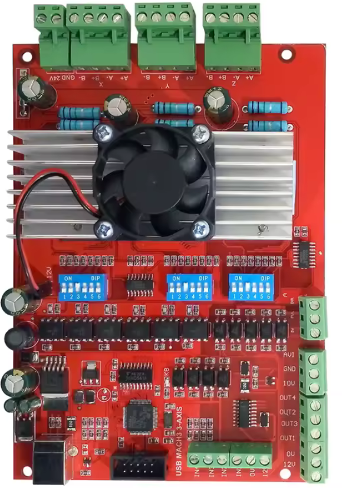

# RNR Eco Motion 2.0 USB protocol (reference)

This document describes the USB protocol of the "RNR Eco Motion 2.0" motion controller as its
Mach3 plugin uses it. It is the reference GRBL2MACH is written against.

**Sources.** USB captures (USBPcap + Wireshark) of Mach3 driving a real board, about 40 captures
covering start-up, arming, e-stop, homing, jogs, MDI moves, a full pocket program, feed hold,
stop, probing, spindle and outputs, and the configuration frame for 15 variants of the input
settings. They were cross-checked against the interoperability notes published by
[BreakoutCNC](https://github.com/rolanddd-hu/BreakoutCNC) and against static analysis of the
vendor plugin (identified below). No vendor code is used or distributed.

**Confidence.** Everything not marked otherwise was **observed** in captures of the reference
board. Points marked *unconfirmed* come from the BreakoutCNC notes or from the plugin only.

## 1. Hardware and plugin identification

| | |
|---|---|
| USB IDs | VID `0xA720`, PID `0xF803` |
| USB strings | manufacturer "RobotAndRobot.com", product "RNR ECO MOTION 2.0", bcdDevice `0x0300` |
| Board (reference) | red board marked "USB MACH3 3-AXIS": three TB6560 stepper drivers (X, Y, Z) on board, step/direction terminal for a fourth axis (A), inputs IN1-IN4, outputs OUT1-OUT4, terminal AVI / GND / 10V (presumably the 0-10 V spindle speed for a VFD, driven by the PWM frame: not tested), motor supply terminal "GND 24V" |
| Mach3 plugin | `RnRMotion.dll`, 275 968 bytes, file version 3.5.0.0, "BS Control Mach3 Plugins" (company "BS", product "BSMotion", original name `BSMotionMini`, © 2010-2016); configuration dialog "Bitsensor Motion Controller Configuration", version 3.50 |
| Plugin SHA-256 | `7551e4221db28706fb48955c15cfbca83a2eac298ed43e586859eb1f07726f07` |

These boards are sold under many names with no common reference: the USB IDs above identify the
protocol. A board answering to them with another plugin version may differ in details.

## 2. USB transport

- USB HID, one interface. Endpoints: interrupt IN `0x81` (64 bytes, bInterval 20), interrupt OUT
  `0x01` (64 bytes, bInterval 1).
- The report descriptor declares three reports:
  - input report ID 1: 48 data bytes (49 with the ID);
  - output report ID 2, **short frame**: 8 data bytes (9 with the ID);
  - output report ID 3, **extended frame**: 26 data bytes (27 with the ID).
- Byte 0 of every frame is the report ID. On Windows, the host writes 27-byte buffers (the
  largest output report, as hidapi does); a frame with ID 2 goes out as a 9-byte transfer.
- All multi-byte values are **little-endian**. Positions and step counts are signed 32-bit.

## 3. Output frames (PC → controller)

### 3.1 Header

| Byte | Content |
|---|---|
| 0 | report ID: `0x02` short frame, `0x03` extended frame |
| 1 | opcode |
| 2 | flags: always `0x00` from Mach3 (BreakoutCNC: `0x40` = limit override, *unconfirmed*) |
| 3-4 | sequence number, uint16, +1 for every frame sent (wraps) |
| 5-26 | payload (short frames: 5-8 only) |

The controller acknowledges a frame in the status report (`rx[3..4]`) as soon as it has
**buffered** it, not when it has executed it.

### 3.2 Opcodes

| Op | Frame | Name (GRBL2MACH) | Payload | Effect |
|---|---|---|---|---|
| `0x01` | short | EStop | — | stops at once, drops the buffer, **disarms** (state 0) |
| `0x02` | short | ClearEStop | — | arms, after `0x07` (state 0 → 1) |
| `0x03` | short | SetOutputs | `[5]` OUT1-OUT4 (bit 0 = OUT1) | sets the outputs at once |
| `0x04` | ext. | GcodeSlice | slice (3.4) | program motion; opens a program run (state 6) |
| `0x05` | ext. | JogSlice | slice (3.4) | motion of a jog, homing or probing run; **ignored in state 1** |
| `0x06` | short | EndOfMotion | `[5]` outputs | ends a run: the buffered slices still run (state 7), then state 1 |
| `0x07` | short | PreReset | — | first frame of the arming sequence |
| `0x08` | short | Cancel | — | stops at once, drops the buffer, **stays armed** (state 1); Mach3's Stop button |
| `0x09` | ext. | SetPositions | `[5+4a]` int32 step counter of axis a (X, Y, Z, A), `[21]` axis mask | sets the step counters of the axes in the mask |
| `0x0A` | short | StartJog | `[5]` axis 0-3 | opens a jog run (state 2) |
| `0x0B` | short | (step/MPG jog) | — | *unconfirmed*, not seen |
| `0x0C` | short | ArmProbe | `[5]` = 0 | opens a probing run (state 5): stops on the probe input, latches the positions |
| `0x0D` | short | ArmHome | `[5]` axis 0-3 | opens a homing run of one axis (state 4): stops on that axis' home input |
| `0x0E` | short | SpindlePwm | `[5-6]` duty, `[7-8]` period (always 1000) | spindle PWM, duty/period |
| `0x0F` | ext. | Configure | see 3.3 | pins, polarities, pulse rate, slice period |
| `0x10` | short | StopJog | — | drops the buffered slices of a jog; the slices sent after it run (deceleration ramp) |

### 3.3 Configure (`0x0F`)

| Byte | Content |
|---|---|
| 5, 7, 9, 11 | limit inputs of X, Y, Z, A: `(limit-- input << 4) \| limit++ input` |
| 6, 8, 10, 12 | home of X, Y, Z, A: `0x40` home active low, `0x20` limit-- active low, `0x10` limit++ active low, low nibble = home input |
| 13 | `(e-stop input << 4) \| probe input` |
| 14 | `0x20` e-stop active low, `0x10` probe active low |
| 15 | step/direction polarity: bits 0-3 step active low X..A, bits 4-7 direction inverted X..A |
| 16 | step pulse frequency, kHz (Mach3: 100) |
| 17 | slice period, ms (Mach3: 5) |
| 18-26 | 0 |

An input number is the board input IN1..IN15 (Mach3: port 3, pin n); **0 = not used**. Mach3
sends the polarity bits even for inputs it does not use. The encoding was decoded from 15 frames,
each with one setting changed in Mach3, and every bit was seen changing. Example, reference
machine (homes X/Y/Z on IN3 active low, A home not used, probe on IN2, e-stop on IN1, no limits,
every input ticked active low except probe and e-stop): `00 73 00 73 00 73 00 70 12 00`.

**The board stops by itself on its e-stop input only if byte 13 declares it.** With byte 13 = 0
the board only reports the input (`rx[42..43]`) and keeps moving: the host must then stop it.

Mach3 settings not sent to the board: input debounce, *Index*, *Limit Override*, *Input #1-#4*
(used by Mach3 itself only).

### 3.4 Slices (`0x04`, `0x05`)

| Byte | Content |
|---|---|
| 5-8 | Mach3: G-code line number of the slice (0-based; 0 in MDI and jogs). Not needed by the board: GRBL2MACH sends 0 |
| 9-24 | signed steps of X, Y, Z, A, int32 each, to output during the slice |
| 25 | outputs OUT1-OUT4 while the slice runs (Mach3: `0x01` in every slice while the spindle turns) |
| 26 | 0 |

- One slice is executed every slice period (Configure byte 16 / 17: **5 ms** with Mach3).
- The board buffers at least 100 slices. Mach3 keeps about 0.5 s (≈ 100 slices) ahead of the
  board, after a first burst of 17 to 41 slices sent 1 ms apart.
- An empty buffer inside a run is not an error: the board waits.

## 4. Status report (controller → PC)

One report about every 50 ms (48 to 51 ms observed), whether the PC sends anything or not.

| Byte | Content |
|---|---|
| 0 | report ID `0x01` |
| 1 | state (section 5) |
| 2 | flags: `0x81` at rest on the reference board; `0x20` = e-stop input active, **only when declared in Configure**; `0x10` = limit (BreakoutCNC, *unconfirmed*) |
| 3-4 | sequence number of the last frame buffered |
| 5-8 | *unknown* |
| 9 + 8a | live step counter of axis a (X, Y, Z, A), int32: steps actually output |
| 13 + 8a | step counter of axis a at the last probe contact (latched; unchanged without contact) |
| 41 | outputs OUT1-OUT4 as applied |
| 42-43 | raw inputs, bit n-1 = IN n (reference board at rest: `0x000C`, IN3/IN4 high) |
| 44-45 | counter, about 1 kHz |
| 46-47 | MPG counter (>> 2, *unconfirmed*) |
| 48 | *unknown* |

## 5. States (`rx[1]`)

| State | Meaning | Entered by | Left by |
|---|---|---|---|
| 0 | e-stop / disarmed | power-up, `0x01`, declared e-stop input | `0x07` + `0x02` (with the input released) |
| 1 | armed, at rest | arming, end of a run, `0x08`, home switch, probe contact | a run |
| 2 | jog run | `0x0A` | `0x06` (→ 7), `0x08` |
| 4 | homing run | `0x0D` | home switch (→ 1), `0x06`, `0x08` |
| 5 | probing run | `0x0C` | probe contact (→ 1), `0x06`, `0x08` |
| 6 | program run | first `0x04` | `0x06` (→ 7), `0x08` |
| 7 | ending | `0x06` | buffer empty (→ 1) |

`0x01` and the declared e-stop input go to state 0 from any state.

## 6. Sequences

### Start-up
Mach3 sends one Configure (`0x0F`) and nothing else; the board stays in state 0 until armed. The
board keeps reporting its status without any frame from the PC: it has **no host watchdog** (it
stayed armed 3 s after Mach3 closed; if the host freezes during a move, the board runs its whole
buffer).

### Arming (Mach3's Reset / Stop button "device ready")
`0x07`, `0x02`, `0x09` (current counters, mask `0x0F`), `0x0F`. Flags byte 0 in all frames.

### Program move (MDI, program, step jog)
GcodeSlices (`0x04`, state 6), then `0x06` once all are sent (state 7), state 1 once they have run.
A whole program can be one run (the reference pocket: 99 040 slices, 497 s, one run).

### Continuous jog
`0x0A` (axis) → state 2, JogSlices (`0x05`). On key release: `0x10` (the board drops its buffer),
then the deceleration slices, then `0x06` → state 7 → 1.

### Stop (Mach3's Stop) and e-stop
- `0x08`: the board stops at the next slice and drops its buffer (≈ 95 slices with Mach3's lead),
  **stays armed** (state 1).
- `0x01`: same stop, then state 0 (arming needed).
- E-stop input declared in Configure: the board stops by itself (state 6 → 0, `rx[2]` bit `0x20`)
  before any frame from the PC. Mach3 also sends `0x01` about 25 ms later. After release, state
  stays 0 until arming.

### Feed hold
No special frame: the host decelerates in its own slices, then `0x06`. With Mach3's 0.5 s lead,
the machine keeps going about 0.5 s before slowing down.

### Homing (one axis)
1. `0x0D` (axis) → state 4, then JogSlices towards the switch. The board stops by itself on the
   home input declared in Configure for that axis (state 4 → 1), exactly on the step that closes
   it, and **ignores the slices still to come** (Mach3 keeps sending some).
2. Pull-off: `0x0A` (axis) + JogSlices away from the switch + `0x06`.
3. Slow approach: `0x0D` again, slower slices; pull-off again.
Mach3 then sets the axis counter with `0x09` (mask = the axis) and resends `0x0F`. The home
position is read in the live counters (`rx[9+8a]`); the latch is not used. Mach3 homes one axis
at a time (Z, X, Y); `0x0D` takes one axis number.

### Probing (G31 / G38.2)
`0x0C` → state 5, then JogSlices. On contact the board stops by itself (state 5 → 1), **latches
all four counters** in `rx[13+8a]` and ignores the slices still to come. Without contact the
slices all run, then `0x06` → state 7 → 1 and the latch keeps its previous value.

### Outputs and spindle
- `M3 S12000` (spindle max 24 000 rpm): OUT1 in `0x06`/`0x03`, then `0x0E` duty 500 / 1000 about
  0.4 s later. `M5`: `0x0E` duty 0 at once, OUT1 off 1 s later (Mach3's spin-down delay).
- Duty = S × plugin *Calibration* / pulley max speed × 1000 (capped at 1000); the plugin's
  *Initial RV* has no effect on it.
- During a run, the outputs are in byte 25 of every slice.
- At rest Mach3 repeats `0x03` or `0x06` (outputs) about every 31 ms, and `0x0E` + `0x03` pairs
  while not armed. Not needed by the board (GRBL2MACH sends nothing at rest).

## 7. Flow control

- The acknowledgement (`rx[3..4]`) follows the frames sent closely: it means "buffered".
  Pacing on acknowledgements alone lets the host run seconds ahead of the machine; a host should
  pace slices on its own clock and keep the lead short (GRBL2MACH: 75 ms; Mach3: 0.5 s).
- The latency of what the host sees is one status period (≈ 50 ms) plus its lead.

## 8. Not known yet

- `0x0B` (step / MPG jog), MPG counter, status bytes 5-8 and 48.
- Status flag `0x10` (limit) and what the board does on a declared limit input during a program.
- Whether `0x0D` accepts several axes, and homing of A.
- Flags byte 2 (`0x40` limit override per BreakoutCNC).
